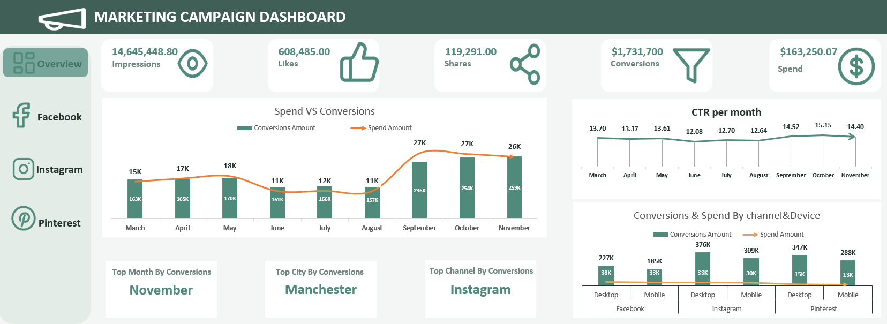
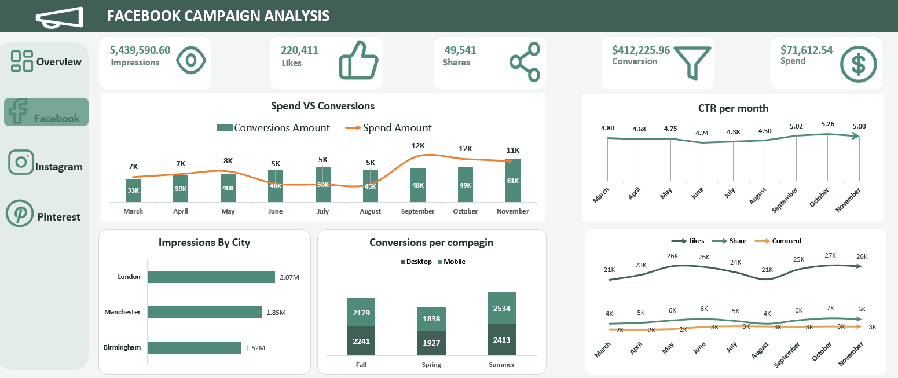
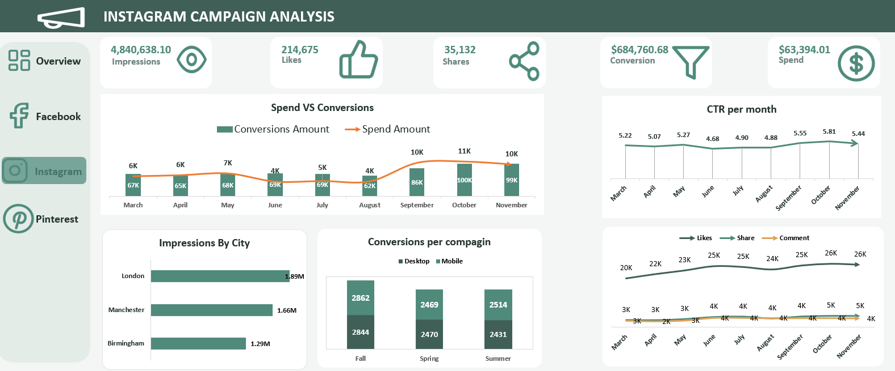
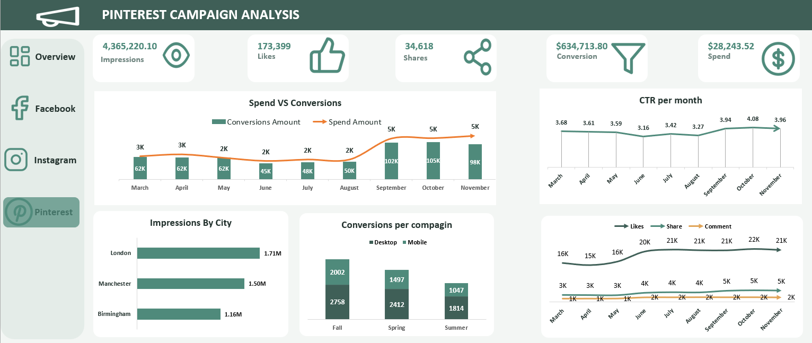

# Marketing Campaign Dashboard (Excel)

A four-page Excel dashboard that compares paid campaign performance across **Facebook, Instagram, and Pinterest** from March to November, and shows which channel returns the most for every dollar spent.

## Summary

- **Pinterest is the most efficient channel**, returning about $22 for every $1 spent (ROAS 22.5), roughly 4x Facebook.
- **Facebook takes about 44% of the budget but produces about 24% of conversion value.**
- **Performance is strongest from September to November**, so campaign effort and budget should be concentrated there.

## Business Question

Where should the marketing budget go? The dashboard answers three questions:

1. How do impressions, engagement, and conversions trend month by month?
2. Which channel, city, campaign season, and device convert best?
3. Which channel returns the most conversion value per dollar spent?

## Key Results

| Metric | Total |
|---|---|
| Impressions | 14.65M |
| Likes | 608K |
| Shares | 119K |
| Conversion Value | $1.73M |
| Spend | $163K |
| **Overall ROAS** (Conversion Value ÷ Spend) | **10.6** |

### Channel Comparison

| Channel | Conversion Value | Spend | ROAS |
|---|---|---|---|
| Pinterest | $634.7K | $28.2K | **22.5** |
| Instagram | $684.8K | $63.4K | 10.8 |
| Facebook | $412.2K | $71.6K | 5.8 |

## Insights

- **Instagram leads in total conversion value** ($684.8K), while **Pinterest is the most efficient** at about $22 returned per $1 spent.
- **Facebook has the highest spend and the lowest return.** It takes about 44% of the budget but produces about 24% of conversion value.
- **Performance steps up from September.** Monthly conversion value rises from $157K in August to $236K in September and peaks at $259K in November, while spend rises over the same period.
- **London leads impressions on all three channels**, but Manchester is the top city by conversions.
- **Click-through rate rises on every platform from September onward.**

## Recommendations

1. **Move part of the Facebook budget to Pinterest.** Raise Pinterest spend in steps and track whether its ROAS holds, since returns often fall as spend grows.
2. **Keep Instagram as the volume channel.** It has the highest total conversion value with a healthy ROAS of 10.8.
3. **Concentrate heavier campaigns in September to November**, when conversion value is highest.
4. **Review Facebook targeting and creative before cutting it further**, since it still contributes $412.2K in conversion value.

## Limitations

- ROAS is based on conversion value, not profit, so product margins are not included.
- The data covers March to November; January, February, and December are not included, so the analysis does not cover the full calendar year.
- Pinterest's high ROAS comes from a small budget and may not hold at higher spend.
- Values in the dataset were modified for confidentiality, so absolute figures should not be read as real business results. The comparisons between channels, months, and cities are what the analysis relies on.
## Dashboard Pages

### 1. Overview
Combined KPIs, Spend vs Conversions, CTR per month, conversions and spend by channel and device, top month, top city, and top channel.

### 2. Facebook Campaign Analysis
Platform KPIs, Spend vs Conversions, CTR per month, impressions by city, conversions per campaign season (Desktop vs Mobile), and the trend of likes, shares, and comments.

### 3. Instagram Campaign Analysis
Same layout as the Facebook page.

### 4. Pinterest Campaign Analysis
Same layout as the Facebook page.

## Tools and Techniques

- **Power Query:** data cleaning and transformation
- **Power Pivot:** data model and relationships
- **DAX:** measures for KPIs and ratios such as ROAS
- **Excel:** PivotTables and PivotCharts, combo charts (columns plus line), shape-based navigation between pages
- **Design:** consistent layout across all pages, KPI cards with icons, hidden gridlines and calculation sheets

## Design Decisions

- **One layout for all channels**, so pages can be compared quickly and the workbook is easy to maintain.
- **A fixed monthly view instead of slicers.** Each platform has its own page, so a channel filter would repeat what the pages already show, and a fixed view keeps the charts consistent across the period.
- **Overview CTR** is a combined CTR across the three platforms, while each platform page shows its own.

## Data

- **Source:** Dataset provided through the Data-X Data Analytics Diploma. It is based on real business data, with values modified to protect confidentiality, so the findings focus on patterns and comparisons between channels rather than exact business figures.
- **Period:** March to November
- **Fields used:** Impressions, Likes, Shares, Comments, CTR, Conversion Value, Spend, Channel, City, Campaign season, Device

## How to Use

1. Download `Marketing-Campaign-Dashboard.xlsx` from this repository.
2. Open it in desktop Microsoft Excel, because the data model uses Power Pivot.
3. Use the side menu to move between the Overview and the three channel pages.
